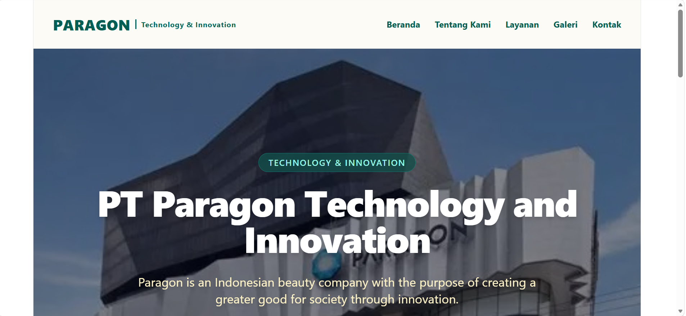
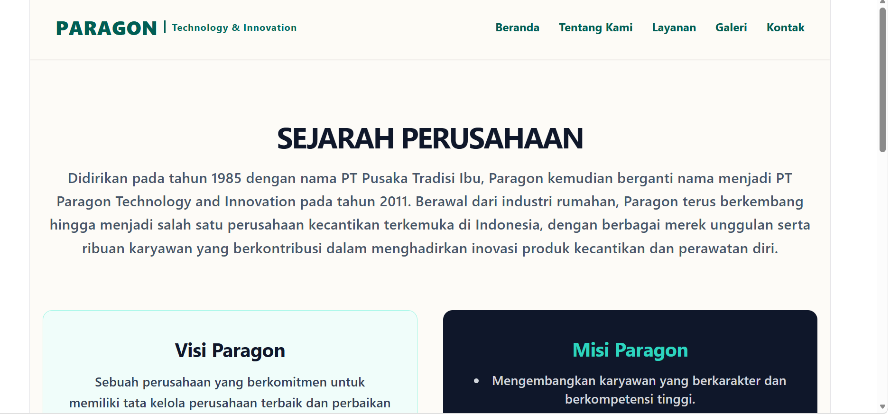
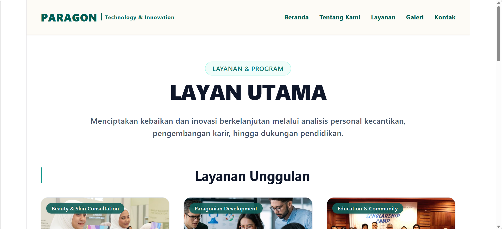
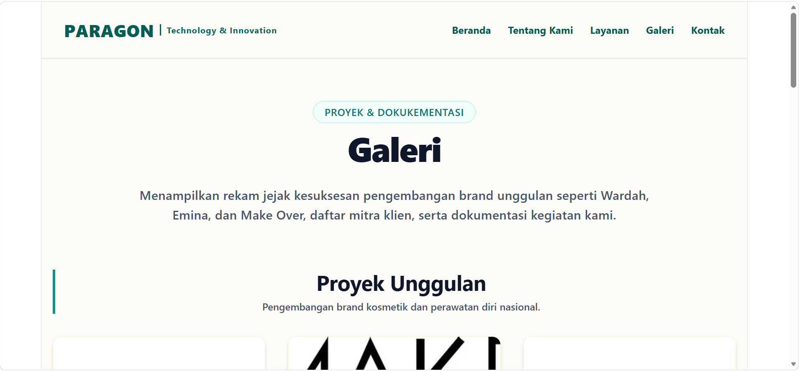
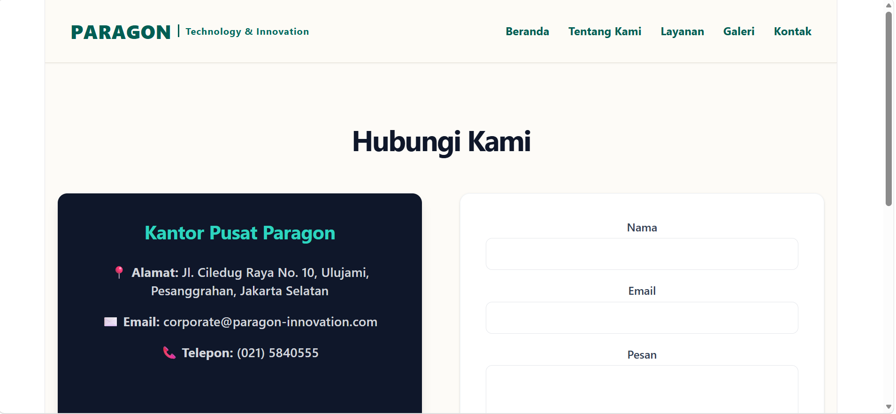

**Company Profile - PT Paragon Technology and Innovation**

Nama: Syakira Azzahra Syihabudin
NIM: 2510827
Kelas: Pendidikan Ilmu Komputer - 3C

Deskripsi Singkat Website
**PT Paragon Technology and Innovation** adalah website *company profile* untuk salah satu perusahaan manufaktur kosmetik nasional terbesar di Indonesia yang menaungi brand-brand ternama seperti Wardah, Make Over, Emina, dan Kahf. Website ini dibuat untuk memperkenalkan Paragon kepada pengunjung, mulai dari profil & sejarah perusahaan, nilai-nilai utama, portofolio brand unggulan, hingga layanan dan program sosial yang dijalankan.

Melalui website ini, pengunjung dapat mengenal Paragon sebagai perusahaan yang berfokus pada inovasi produk berkualitas tinggi, aman, dan halal, serta berkomitmen menciptakan kebaikan (*creating a greater good*) bagi masyarakat dan lingkungan.

---

## Fitur Website

- **Beranda (Home)**  
  Menampilkan halaman utama yang memperkenalkan profil singkat PT Paragon Technology and Innovation, *hero banner* bertema *Technology & Innovation*, serta *highlight* produk-produk unggulan.

- **Tentang Kami (About)**  
  Berisi sejarah singkat berdiri dan berkembangnya Paragon, visi, serta poin-poin misi perusahaan dalam menciptakan kebermanfaatan.

- **Layanan (Services)**  
  Menampilkan daftar layanan dan program utama perusahaan seperti *Personal Analysis* (konsultasi kecantikan), *Career Opportunities* (pengembangan Paragonian), dan *Scholarship Program* (beasiswa pendidikan), dilengkapi dengan ulasan dan testimoni dari pelanggan/klien.

- **Portofolio (Galeri)**  
  Menampilkan contoh rekam jejak proyek pengembangan brand besar (Wardah, Emina, Make Over), daftar klien & mitra kerja sama, serta galeri dokumentasi kegiatan & event penting perusahaan.

- **Kontak (Contact)**  
  Menyediakan informasi lokasi kantor pusat, alamat email, tautan media sosial resmi, dan formulir pesan langsung bagi pengunjung atau mitra yang ingin berkolaborasi.

---

## Cara Menjalankan Proyek

1. Buka folder proyek melalui **Visual Studio Code**.
2. Buka terminal pada folder proyek tersebut.
3. Jalankan perintah *install dependencies* (jika baru pertama kali mengunduh/clone repositori):
   ```bash
   npm install

   ## screenshoot

### Beranda


### Tentang Kami


### Layanan


### Portofolio


### Kontak
